Image CaptioningTotal images, 32

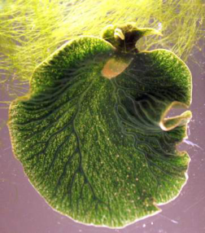

Captions: FRAGMENT

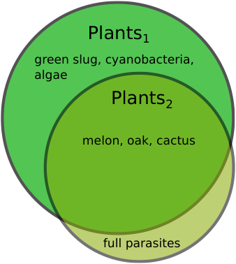

Captions: FRAGMENT

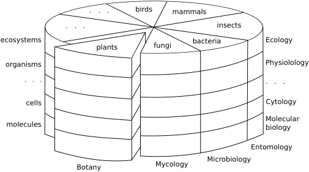

Captions: Biological classification system showing taxonomic groups such as plants, fungi, bacteria, insects, mammals, and birds alongside levels of organization and scientific disciplines.

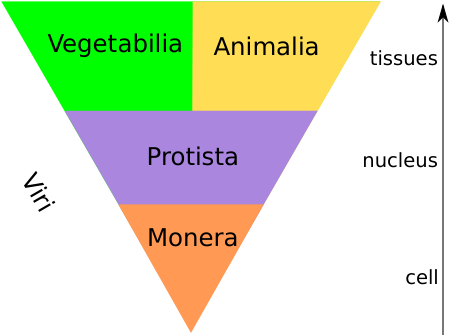

Captions: Biological classification system showing the kingdoms Vegetabilia, Animalia, Protista, and Monera, alongside Viri and levels of cellular complexity.

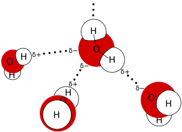

Captions: FRAGMENT

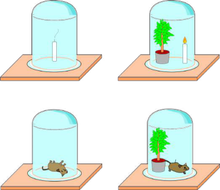

Captions: Photosynthesis experiment showing Priestley's bell jar setup with a plant, a burning candle, and a mouse.

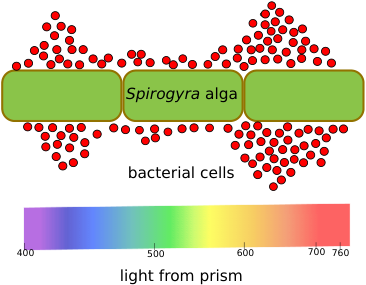

Captions: This diagram illustrates the action spectrum of photosynthesis showing the *Spirogyra* alga, bacterial cells, and light from a prism with wavelength measurements from 400 to 760 nm.

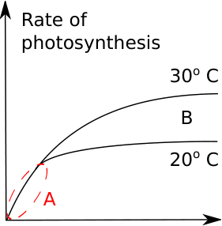

Captions: Photosynthesis cycle showing the rate of photosynthesis at 30° C and 20° C with labels A and B.

Captions: FRAGMENT

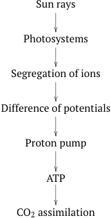

Captions: Photosynthesis cycle showing sun rays, photosystems, segregation of ions, difference of potentials, proton pump, ATP, and CO2 assimilation.

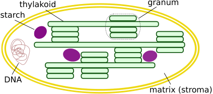

Captions: Chloroplast structure showing the thylakoid, granum, starch, DNA, and matrix (stroma).

Captions: FRAGMENT

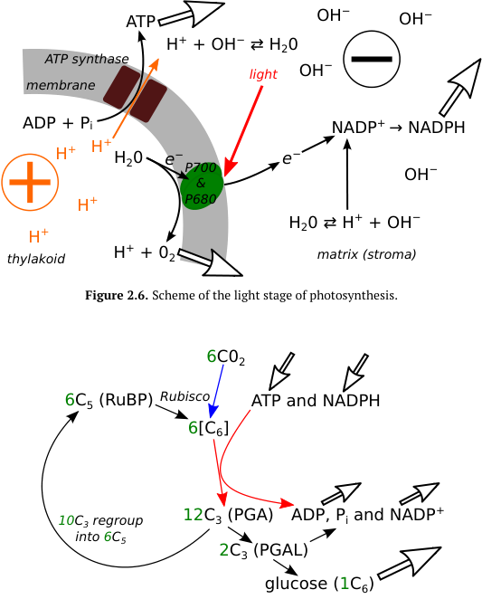

Captions: Photosynthesis cycle showing the light stage and the Calvin cycle with ATP synthase, thylakoid, stroma, and chemical intermediates such as ADP, NADPH, RuBP, and glucose.

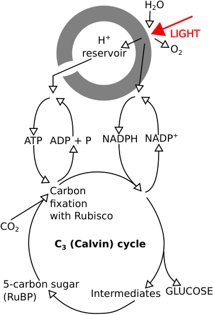

Captions: Photosynthesis cycle showing the light reactions, H+ reservoir, ATP, NADPH, and the C3 (Calvin) cycle with carbon fixation, RuBP, and glucose production.

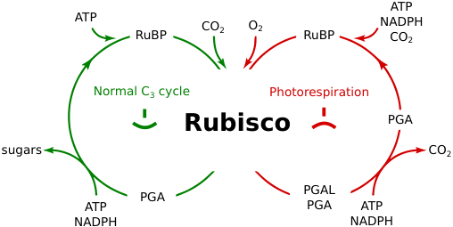

Captions: Photosynthesis cycle comparing the normal C3 cycle and photorespiration mediated by Rubisco, showing inputs and outputs including ATP, NADPH, CO2, O2, RuBP, PGA, PGAL, and sugars.

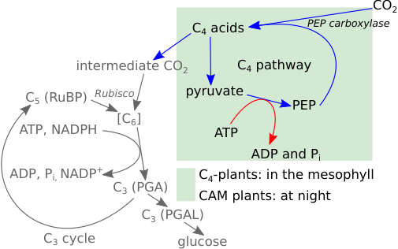

Captions: Photosynthesis cycle showing the C4 pathway, C3 cycle, CO2 fixation by PEP carboxylase and Rubisco, and intermediate molecules including pyruvate, PEP, RuBP, PGA, PGAL, and glucose.

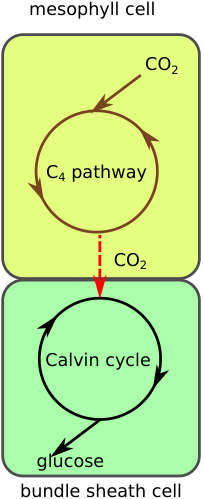

Captions: Photosynthesis cycle showing the C4 pathway, CO2 fixation, and the Calvin cycle in mesophyll and bundle sheath cells.

Captions: FRAGMENT

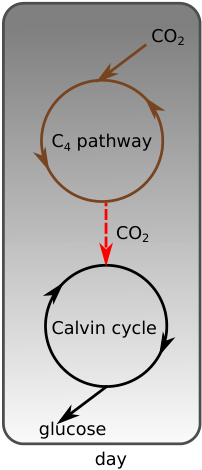

Captions: Photosynthesis cycle showing the C4 pathway, CO2 fixation, Calvin cycle, and glucose production.

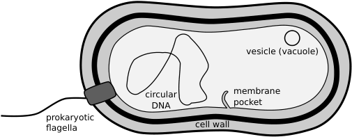

Captions: Prokaryotic cell structure, showing the cell wall, prokaryotic flagella, circular DNA, membrane pocket, and vesicle (vacuole).

Captions: FRAGMENT

Captions: FRAGMENT

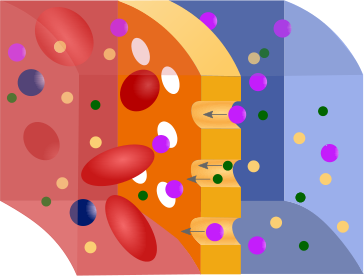

Captions: Plant cell structure showing molecules passing through a selectively permeable membrane via pores.

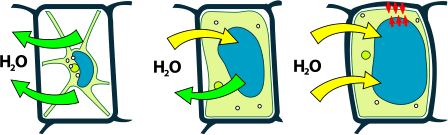

Captions: Plant cell structure, showing water (H2O) movement across the cell membrane into and out of the vacuole.

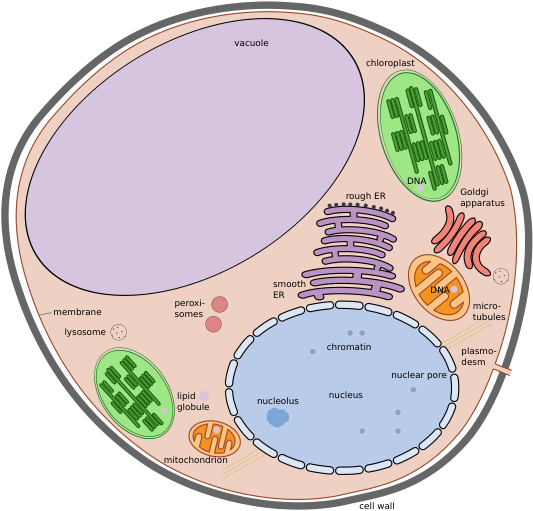

Captions: Plant cell structure showing the cell wall, membrane, vacuole, chloroplast, rough ER, smooth ER, Golgi apparatus, mitochondrion, peroxisomes, lysosome, lipid globule, micro-tubules, plasmodesm, chromatin, nucleolus, nucleus, and nuclear pore.

Captions: FRAGMENT

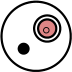

Captions: FRAGMENT

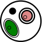

Captions: FRAGMENT

Captions: FRAGMENT

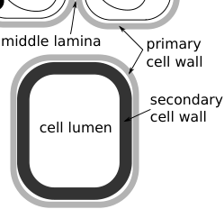

Captions: Plant cell structure showing the middle lamella, primary cell wall, secondary cell wall, and cell lumen.

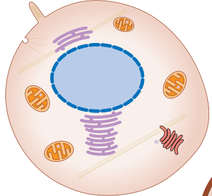

Captions: Plant cell structure, showing the nucleus, mitochondria, and endoplasmic reticulum.

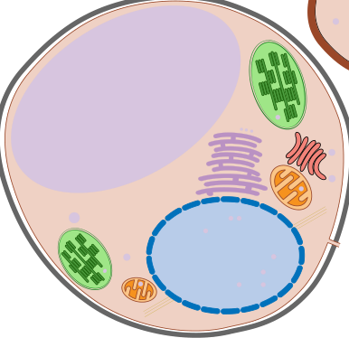

Captions: Plant cell structure, showing the nucleus, vacuole, chloroplasts, mitochondria, and endoplasmic reticulum.

