# Image Captions

Total images: **32**

---

## Zoology.pdf-0021-01.png

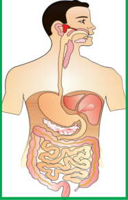

This diagram illustrates the human digestive system. The image displays a human body overview highlighting the organs involved in processing food. It shows various internal organs sequentially arranged from the head down through the torso, mapping out the full length of the digestive tract. There are no text labels, formulas, values, or equations visible in this diagram.

---

## Zoology.pdf-0023-05.png

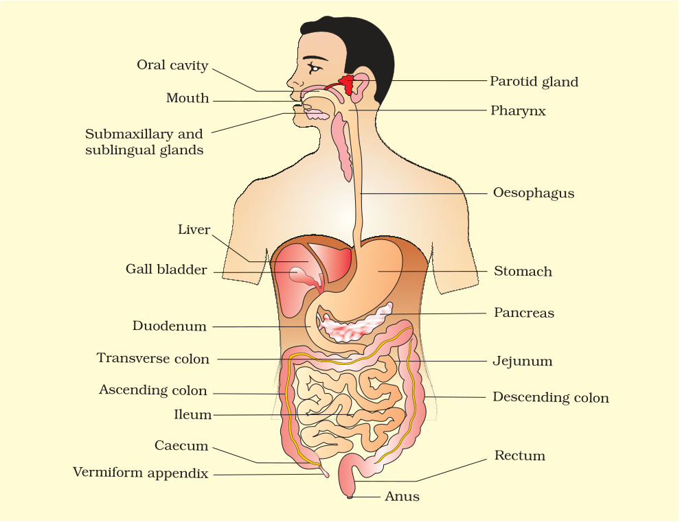

This diagram illustrates the human digestive system. The labeled parts include the oral cavity, mouth, submaxillary and sublingual glands, parotid gland, pharynx, oesophagus, stomach, liver, gall bladder, pancreas, duodenum, transverse colon, jejunum, ascending colon, descending colon, ileum, caecum, vermiform appendix, rectum, and anus. Food enters through the mouth and oral cavity, passing sequentially down the pharynx and oesophagus into the stomach. From the stomach, contents move through the duodenum, jejunum, and ileum, and subsequently pass through the ascending colon, transverse colon, descending colon, caecum, and rectum before exiting via the anus. Associated structures such as the submaxillary and sublingual glands, parotid gland, liver, gall bladder, and pancreas connect along this pathway to contribute to the digestive tract.

---

## Zoology.pdf-0024-04.png

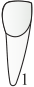

This diagram illustrates a biological structure, specifically a single tooth labeled with the number 1. The diagram shows the entire outline of the tooth, consisting of an upper exposed portion and a tapered root extending downward. The labeled part, designated simply as 1, represents the bottom tip or apex of the root. Based on the visual layout, the upper portion and the tapered root function together as an integrated anatomical unit. There are no additional labels, formulas, or values visible in the diagram.

---

## Zoology.pdf-0024-05.png

This diagram illustrates a biological structure or cellular feature marked with the lowercase letter "a". The letter "a" serves as a label identifying this specific region or component within the visual structure. No other parts, formulas, or values are visible in this specific cropped section of the diagram. Consequently, no functional relationships between multiple parts can be determined from this view. The image presents only a single outlined shape accompanied by the label "a".

---

## Zoology.pdf-0024-06.png

This diagram displays different types of teeth found in an anatomical structure. Specifically, it labels the components as "Can" and "Premolars" with a directional pointer extending towards specific tooth categories. The label "Can" likely refers to canines, while "Premolars" designates the premolar teeth positioned adjacently within the jaw structure. Functionally, these adjacent dental structures work in coordination during mastication, where canines assist in gripping or tearing food and premolars engage in crushing and grinding.

---

## Zoology.pdf-0024-07.png

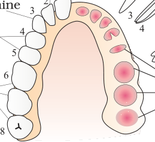

This diagram illustrates the anatomical arrangement of teeth within a human jawbone structure. The left side explicitly labels various numbered tooth types including canine, 3, 4, 5, 6, and 8, displaying their sequential morphological progression along the dental arch. The right side shows developing tooth buds or roots embedded in the underlying tissue corresponding positionally to these same dental positions. Functionally, the diagram links the visible crown structures on one side with their underlying developmental or root foundations shown in pink on the opposing side.

---

## Zoology.pdf-0024-08.png

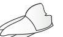

This diagram illustrates a zoological structure, presenting an outline of an anatomical shape viewed from an angle. The provided image shows only the unlabeled, outlined form without any visible text labels, parts, or structural indicators. Because no specific functional relationships between parts are depicted in this isolated graphic, none can be described. Furthermore, there are no formulas, values, or equations visible anywhere within the diagram.

---

## Zoology.pdf-0024-12.png

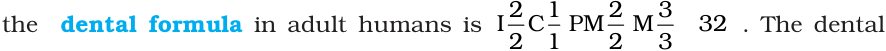

This diagram illustrates the dental formula in adult humans. It shows four categories of teeth designated by the letters I, C, PM, and M. Specifically, the parts displayed are incisors with a ratio of 2 over 2, canines with a ratio of 1 over 1, premolars with a ratio of 2 over 2, and molars with a ratio of 3 over 3, which collectively total 32 teeth. The formula expresses the numerical proportion of each tooth type for one side of the upper and lower jaws.

---

## Zoology.pdf-0025-01.png

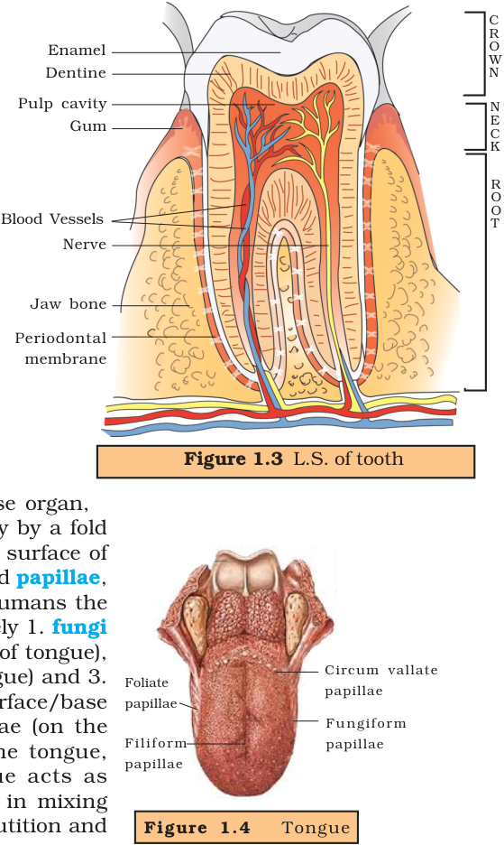

This diagram illustrates the longitudinal section (L.S.) of a mammalian tooth, divided into three main regions labeled as the Crown, Neck, and Root. The outermost layer of the crown is protected by enamel, which sits above the underlying dentine and central pulp cavity. Deep within the tooth structure, blood vessels and a nerve travel through the root and into the pulp cavity to supply the inner tissues. The entire tooth is anchored within the jaw bone, surrounded by the gum at the neck level and a periodontal membrane along the root.

---

## Zoology.pdf-0026-04.png

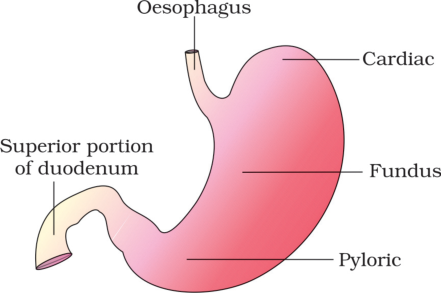

This diagram illustrates the anatomical structure of the stomach and its surrounding regions. The labeled parts include the oesophagus, which connects to the upper region of the stomach, and the superior portion of the duodenum, which extends from the lower region. Within the main body of the stomach, the labeled sections consist of the cardiac, the fundus, and the pyloric regions. Functionally, material passes downward from the oesophagus into the cardiac and fundus regions, proceeds through the pyloric region, and exits directly into the superior portion of the duodenum.

---

## Zoology.pdf-0027-03.png

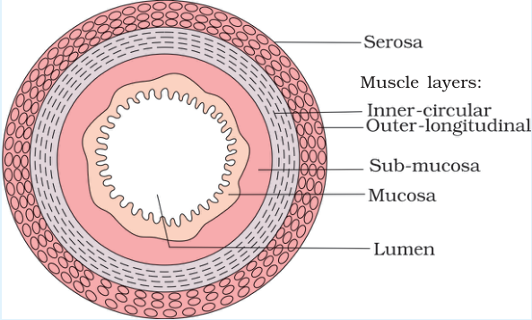

This diagram illustrates the cross-sectional anatomy of the gut wall. The central opening is the lumen, which is surrounded by the innermost layer called the mucosa. Surrounding the mucosa is the sub-mucosa, followed by two distinct muscle layers labeled as the inner-circular and outer-longitudinal layers. The outermost layer enclosing these concentric structures is the serosa.

---

## Zoology.pdf-0029-04.png

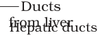

This diagram illustrates anatomical structures associated with the digestive or biliary system. Specifically, it displays the "Ducts from liver", which are also labeled as "Hepatic ducts". These labeled parts represent tubular pathways originating from the liver. Based on the provided labels, the hepatic ducts function as conduits for transporting substances from the liver.

---

## Zoology.pdf-0029-05.png

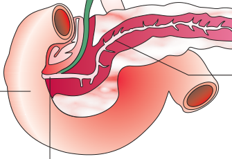

This diagram illustrates anatomical structures associated with the digestive system, specifically showing the relationship between the pancreas and the surrounding intestinal tract. The illustration highlights internal duct networks running through the red-colored glandular tissue of the pancreas, which branch outward. A green tube (representing a duct, such as the bile duct) joins with the pancreatic duct system near the intestinal wall. The larger pink, curved loop structure frames the reddish pancreatic tissue, showing their close anatomical proximity. There are no formulas, values, or equations visible in this diagram.

---

## Zoology.pdf-0029-07.png

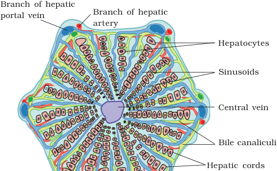

This diagram illustrates the structural organization of a liver lobule, detailing its cellular arrangement and vascular pathways. The labeled parts include hepatocytes arranged in hepatic cords, sinusoids, bile canaliculi, a central vein, a branch of the hepatic portal vein, and a branch of the hepatic artery. Functionally, blood from the branch of the hepatic portal vein and the branch of the hepatic artery flows through the sinusoids past the hepatocytes, eventually converging at the central vein. Concurrently, the hepatocytes secrete substances into the interspersed bile canaliculi. There are no formulas or numerical values visible in the diagram.

---

## Zoology.pdf-0033-04.png

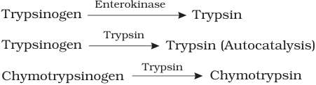

This diagram illustrates enzymatic conversion pathways involving inactive precursors and active enzymes. The top pathway shows Trypsinogen converted into Trypsin via the action of Enterokinase. In the middle pathway, Trypsinogen is converted into Trypsin through autocatalysis mediated by Trypsin itself. The bottom pathway demonstrates Chymotrypsinogen being converted into Chymotrypsin by Trypsin. Functionally, these reactions represent how activating agents—such as Enterokinase and Trypsin—catalyze the transformation of inactive precursor proteins into their active enzyme forms.

---

## Zoology.pdf-0033-10.png

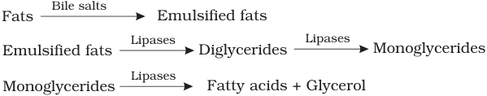

This diagram illustrates the sequential breakdown of fats into simpler components. In the first step, Fats are acted upon by Bile salts to form Emulsified fats. Subsequently, Emulsified fats are converted into Diglycerides through the action of Lipases, with Lipases further acting on Diglycerides to yield Monoglycerides. Finally, Lipases act upon Monoglycerides to produce Fatty acids plus Glycerol.

---

## Zoology.pdf-0039-01.png

Based on the provided image, there are no visible text labels, equations, formulas, or descriptive callouts to identify specific biological structures, parts, or values. The diagram simply displays a geometric arrangement of colored hexagonal shapes in pink, green, orange, and blue against a background. Without explicit textual annotations or labels present in the image, it is not possible to describe specific biological processes, roles, or functional relationships using labeled parts.

---

## Zoology.pdf-0041-04.png

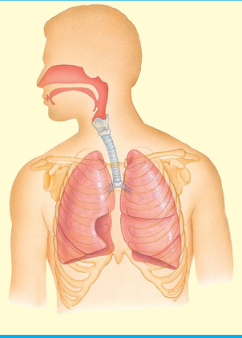

This diagram illustrates the human respiratory system. It shows an anatomical overview of the human head and torso, highlighting the upper and lower respiratory structures. Specifically, it depicts the nasal cavity, oral cavity, pharynx, larynx, trachea, bronchi, and lungs contained within the rib cage. Air passes sequentially through these upper passages down into the trachea and branching bronchi to reach the lungs. No labels, formulas, values, or equations are visible in this illustration.

---

## Zoology.pdf-0044-08.png

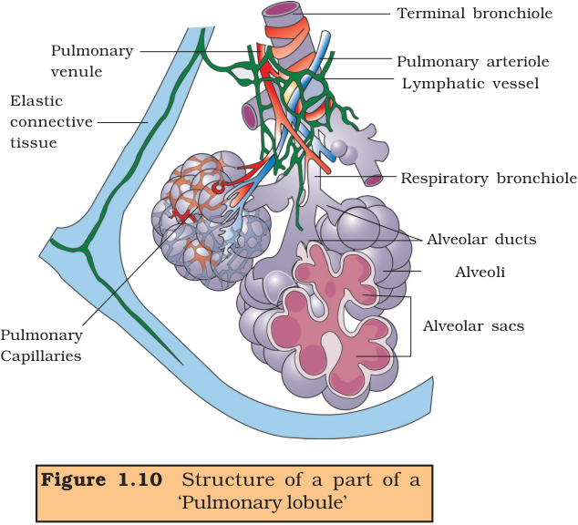

Figure 1.10 illustrates the anatomical structure of a part of a pulmonary lobule, detailing the arrangement of respiratory airways, vascular networks, and supportive tissue. The diagram displays a terminal bronchiole branching into a respiratory bronchiole, which further leads to alveolar ducts, alveoli, and alveolar sacs where gas exchange occurs. Interwoven with these respiratory structures are a pulmonary arteriole, pulmonary venule, pulmonary capillaries, and a lymphatic vessel. Additionally, elastic connective tissue is shown providing structural support along the outer boundary of the lobule.

---

## Zoology.pdf-0045-04.png

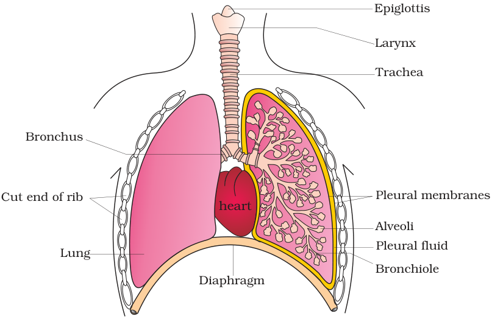

This diagram illustrates the human respiratory system, showing the major anatomical structures involved in breathing. Air enters through the larynx and passes down the trachea, which branches into a bronchus leading into each lung. Within the lungs, the bronchi further subdivide into smaller bronchioles that terminate in clusters of alveoli. The lungs are enclosed by pleural membranes containing pleural fluid and are protected by the cut ends of ribs and supported below by the diaphragm, alongside the centrally positioned heart.

---

## Zoology.pdf-0046-09.png

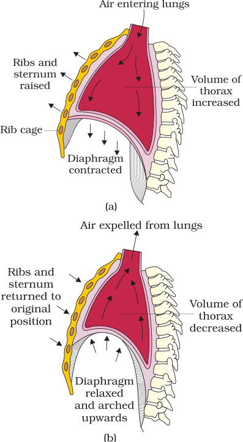

This diagram illustrates the mechanics of breathing through the states of inspiration (a) and expiration (b). In part (a), the ribs and sternum are raised and the diaphragm is contracted downward, which increases the volume of the thorax and allows air entering lungs. Conversely, in part (b), the ribs and sternum are returned to their original position and the diaphragm is relaxed and arched upwards, which decreases the volume of the thorax and causes air expelled from lungs.

---

## Zoology.pdf-0048-02.png

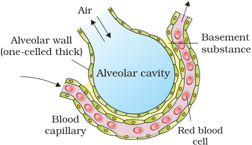

This diagram illustrates the structure of an alveolus and its associated respiratory membrane components. It shows an alveolar cavity containing air, surrounded by an alveolar wall that is described as one-celled thick. Adjacent to the alveolar wall is a blood capillary that contains red blood cells. A layer of basement substance is positioned between the alveolar wall and the blood capillary. Functionally, the air flows into the alveolar cavity, while red blood cells travel through the blood capillary past the alveolar wall, which is separated from the capillary by the basement substance.

---

## Zoology.pdf-0048-03.png

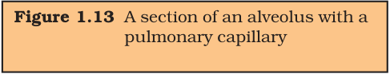

Figure 1.13 is a text-based diagram heading titled "A section of an alveolus with a pulmonary capillary." The image displays only the text box identifying this anatomical subject without showing any visual illustration of the tissues or cellular structures. Based on the provided text, the diagram represents a microscopic anatomical section featuring both an alveolus and a pulmonary capillary. The heading establishes the relationship between these two structures as adjacent components within the pulmonary system. No specific formulas, values, equations, or further structural labels are visible within this text-only figure.

---

## Zoology.pdf-0048-04.png

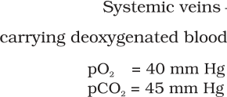

[FAILED]

---

## Zoology.pdf-0048-05.png

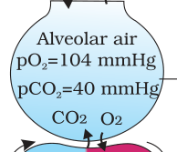

This diagram illustrates the exchange of gases between alveolar air and blood within the respiratory system. The structures shown include Alveolar air containing specific gas pressures, along with the gases carbon dioxide and oxygen. For the alveolar air, the partial pressure of oxygen is equal to one hundred four millimeters of mercury, and the partial pressure of carbon dioxide is equal to forty millimeters of mercury. Functionally, oxygen moves from the alveolar air into the adjacent blood vessel, while carbon dioxide moves in the opposite direction from the blood into the alveolar air.

---

## Zoology.pdf-0048-06.png

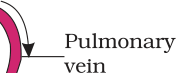

This diagram illustrates a segment of a biological vessel or structure labeled as the pulmonary vein. The visual depicts a curved, pink, tubular wall section with an accompanying directional arrow that points toward the vessel wall. Although specific formulas or equations are not present, the structural component is explicitly named. The labeled part functions as a vessel wall targeted by the directional indicator. Together, these elements identify a specific anatomical pathway associated with the pulmonary vein.

---

## Zoology.pdf-0048-07.png

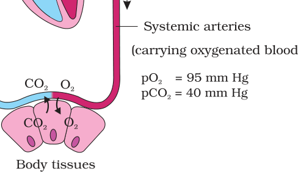

This diagram illustrates the exchange of gases between systemic arteries and body tissues. Systemic arteries are shown carrying oxygenated blood downward toward the tissues. The partial pressure of oxygen is equal to ninety-five millimeters of mercury, and the partial pressure of carbon dioxide is equal to forty millimeters of mercury. Functionally, oxygen is delivered from the systemic arteries into the body tissues, while carbon dioxide is transferred in the opposite direction from the body tissues.

---

## Zoology.pdf-0049-11.png

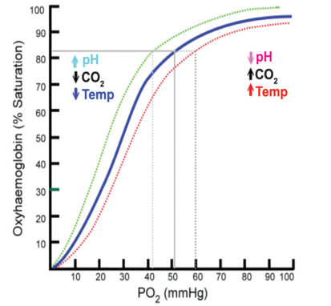

This diagram illustrates the relationship between Oxyhaemoglobin percent saturation and partial pressure of oxygen, labeled as P O subscript 2 in millimeters of mercury. The vertical axis measures Oxyhaemoglobin in percent saturation from zero to one hundred, while the horizontal axis measures partial pressure of oxygen from zero to one hundred millimeters of mercury. The graph displays a central blue curve representing baseline conditions, alongside shifted curves associated with two specific physiological states. One state involves an increased pH, decreased carbon dioxide, and decreased temperature, while the opposing state involves a decreased pH, increased carbon dioxide, and increased temperature. Functionally, these varying conditions shift the oxygen dissociation curves, altering the percent saturation of oxyhaemoglobin at given partial pressures of oxygen as indicated by the plotted reference lines.

---

## Zoology.pdf-0051-11.png

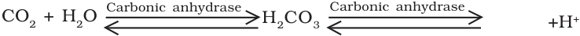

This diagram illustrates a reversible biochemical reaction involving carbon dioxide and water. The chemical equation shows that carbon dioxide plus water, written as C O subscript 2 plus H subscript 2 O, reacts in the presence of carbonic anhydrase to form carbonic acid, written as H subscript 2 C O subscript 3. The diagram further shows that carbonic acid can dissociate into hydrogen ions, written as plus H superscript positive, in another step facilitated by carbonic anhydrase. Both stages of the reaction are depicted with bidirectional arrows, indicating that the processes can proceed in forward and reverse directions.

---

## Zoology.pdf-0052-06.png

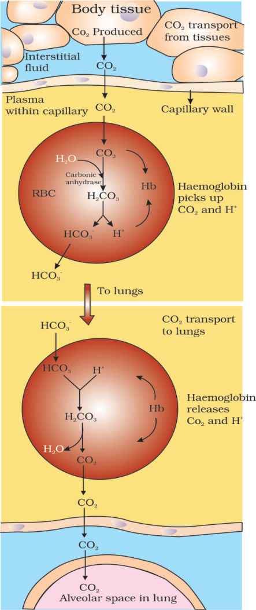

This diagram illustrates the biological process of carbon dioxide transport from body tissues to the lungs and its subsequent elimination. The parts shown include body tissue producing carbon dioxide, interstitial fluid, a capillary wall, plasma within the capillary, and red blood cells (RBC). Within the red blood cell, water combines with carbon dioxide with the help of carbonic anhydrase to form carbonic acid, which then dissociates into bicarbonate ions and hydrogen ions. Functionally, when carbon dioxide is produced in body tissue, it diffuses through interstitial fluid and the capillary wall into the plasma and into a red blood cell, where haemoglobin picks up carbon dioxide and hydrogen ions while bicarbonate ions are transported out. Conversely, when transported to the lungs, bicarbonate ions enter the red blood cell to combine with hydrogen ions, forming carbonic acid which breaks down into water and carbon dioxide, allowing haemoglobin to release carbon dioxide and hydrogen ions so carbon dioxide can diffuse into the alveolar space in the lung. The chemical formulas and molecules visible in the diagram are H subscript 2 O, C O subscript 2, H subscript 2 C O subscript 3, H C O subscript 3 superscript negative, H superscript positive, and Hb.

---

## Zoology.pdf-0053-01.png

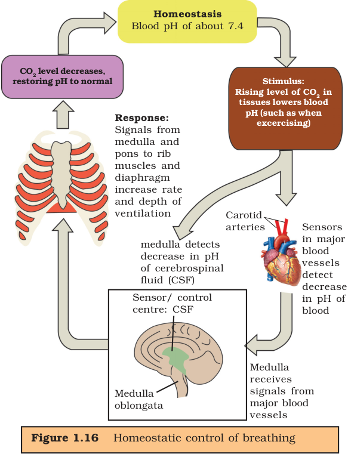

This diagram illustrates the homeostatic control of breathing, which maintains a blood pH of about 7.4. The process begins with a stimulus in which a rising level of carbon dioxide in tissues lowers blood pH. This stimulus is detected either directly as the medulla detects a decrease in pH of cerebrospinal fluid or via sensors in major blood vessels (such as the carotid arteries) that detect a decrease in pH of blood and send signals to the medulla. Functionally, the medulla oblongata acts as a sensor and control centre, sending response signals from the medulla and pons to the rib muscles and diaphragm. These signals increase the rate and depth of ventilation, which causes the carbon dioxide level to decrease, thereby restoring the pH to normal and returning the system to homeostasis.

---

## Zoology.pdf-0057-01.png

This diagram is a graphical illustration containing abstract geometric shapes and colors without any biological labels, text, formulas, or equations visible. Because it lacks textual annotations or specific zoological indicators, it does not display any identifiable biological structure, process, or concept. Consequently, there are no specific parts, roles, or functional relationships to report based strictly on the provided image.

---

